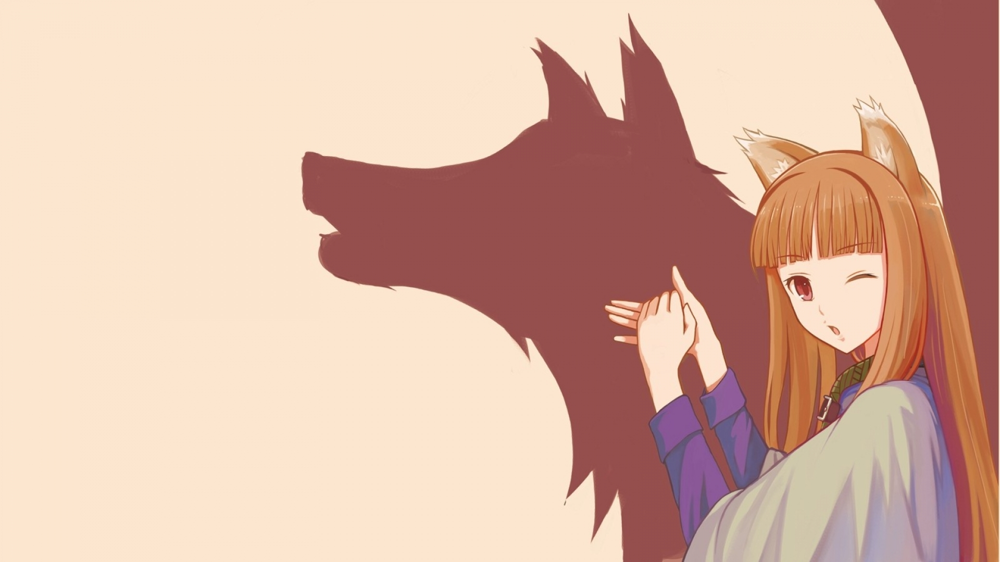

# 

<!-- Hero Banner / Typing SVG -->

  
  
  
  

  <i>"Bridging intelligent algorithms with cinematic visual design and human-centric experiences."</i>

---

## 🌌 About Me

I am a Computer Science undergraduate (B.Tech '27 at MIET Jammu) working at the intersection of **Artificial Intelligence**, **Edge Systems**, and **High-Fidelity Visual Media**. 

I believe code is only half the story — the craft lies in creating systems that not only compute with precision but communicate with elegance. Whether it's architecting real-time emergency dispatch control towers, training neural networks for automated agricultural intelligence, or producing motion graphics with frame-by-frame precision, I obsess over both the logic under the hood and the visual harmony on screen.

- 🧠 **Deep Learning & Intelligent Systems:** Exploring multimodal architectures, computer vision pipelines, and LLM integrations.
- 🎨 **Creative Media & Design:** Experienced in video editing, motion design, and visual compositing using **Adobe Premiere Pro**, **After Effects**, and **Photoshop** — paired with a sharp eye for modern UI/UX design in **Figma**.
- 🛡️ **Cybersecurity & Automation:** Certified in **Google Cybersecurity** & **Cisco SOC Operations** with hands-on RPA workflow automation (UiPath).
- 🎮 **Passions & Vibe:** Generative AI workflows (ComfyUI), speech & whisper pipelines, game tech, anime storytelling, and crafting tools that solve real problems.

---

## ⚡ Superpowers & Creative Edge

<table>
  <tr>
    <td width="50%" valign="top">
      <h3 align="center">🤖 Intelligent Systems & Engineering</h3>
      <ul>
        <li><b>Computer Vision & Multimodal AI:</b> PyTorch, TensorFlow, CNNs, heterogeneous late-fusion image+text models.</li>
        <li><b>Generative AI & Audio:</b> ComfyUI custom generation workflows, Whisper transcription pipelines, TTS synthesis.</li>
        <li><b>Full-Stack & Cloud:</b> Python, C/C++, JavaScript (ES6+), React 18, Node.js, REST APIs, Docker, Vite.</li>
        <li><b>IoT & Embedded Intelligence:</b> Multi-modal sensor telemetry, MQTT, real-time crisis dispatch systems.</li>
        <li><b>Security & SOC:</b> Network security fundamentals, Wireshark, incident detection, NIST framework.</li>
      </ul>
    </td>
    <td width="50%" valign="top">
      <h3 align="center">🎬 Creative Media & Design Craft</h3>
      <ul>
        <li><b>Adobe Premiere Pro:</b> Advanced narrative pacing, color correction, multi-track audio mastering, and rhythmic editing.</li>
        <li><b>Adobe After Effects:</b> Kinetic typography, motion graphics, VFX compositing, tracking, and micro-animations.</li>
        <li><b>Adobe Photoshop:</b> Visual manipulation, concept mockups, raster asset design, and brand aesthetics.</li>
        <li><b>UI/UX & Product Design:</b> Figma design systems, dark-mode glassmorphism, responsive visual hierarchies.</li>
        <li><b>Visual Sensibility:</b> Ruthless attention to typography, spatial rhythm, contrast ratios, and visual clarity.</li>
      </ul>
    </td>
  </tr>
</table>

---

## 🛠️ The Tech & Creative Toolbox

### 💻 Code & Frameworks

  
  
  
  
  
  
  
  
  

### 🧠 AI / ML & Data Science

  
  
  
  
  
  
  

### 🎨 Creative Suite & Visual Design

  
  
  
  
  

### ⚙️ Tools, Ops & Security

  
  
  
  
  
  
  

---

## 🚀 Highlighted Projects

<table width="100%">
  <tr>
    <td width="50%" valign="top">
      <h3>🚨 <a href="https://github.com/RghavSrdhtra">NexCommand — Rapid Crisis Response Platform</a></h3>
      
<b>Intelligent Emergency Dispatch & Control Tower</b>

      <ul>
        <li>Real-time incident ingestion paired with an automated resource allocation engine.</li>
        <li>Integrated with <b>Google Gemini AI</b> to generate split-second tactical situation briefs for emergency coordinators.</li>
        <li>Designed with a sleek, low-latency <b>dark-mode glassmorphic mission control UI</b> to minimize cognitive strain during high-stress crises.</li>
      </ul>
      

        <code>JavaScript</code> <code>Gemini Flash API</code> <code>CSS Glassmorphism</code> <code>Vite</code>
      

    </td>
    <td width="50%" valign="top">
      <h3>🌿 <a href="https://github.com/RghavSrdhtra">SilkSphere — Smart Sericulture Ecosystem</a></h3>
      
<b>Multi-Modal IoT & Computer Vision for Agriculture</b>

      <ul>
        <li>IoT sensor telemetry monitoring temperature, humidity, and atmospheric metrics in real-time.</li>
        <li>Custom <b>Convolutional Neural Network (PyTorch)</b> for early silkworm disease detection and automated cocoon grading.</li>
        <li>Cross-platform farmer dashboard built with <b>React 18</b> delivering live visual analytics and early contagion alerts.</li>
      </ul>
      

        <code>Python</code> <code>PyTorch</code> <code>IoT / MQTT</code> <code>React.js</code>
      

    </td>
  </tr>
  <tr>
    <td width="50%" valign="top">
      <h3>🧬 <a href="https://github.com/RghavSrdhtra">Multimodal Deep Learning Classification</a></h3>
      
<b>Heterogeneous Data Stream Fusion Architecture</b>

      <ul>
        <li>Engineered a modular PyTorch architecture fusing multi-spectral images and structured textual metadata.</li>
        <li>Implemented late-fusion neural representations, custom preprocessing pipelines, and interactive evaluation telemetry.</li>
      </ul>
      

        <code>PyTorch</code> <code>TensorFlow</code> <code>Pandas</code> <code>Plotly</code>
      

    </td>
    <td width="50%" valign="top">
      <h3>🛡️ <a href="https://github.com/RghavSrdhtra">AI IDS & Audio / Media Intelligence Tools</a></h3>
      
<b>Threat Classification, Whisper Pipelines & Creative Tech</b>

      <ul>
        <li><b>AI Intrusion Detection:</b> Machine learning classifiers for real-time network anomaly identification.</li>
        <li><b>Speech & Media Pipelines:</b> Local Whisper transcription, audio processing, and generative media synthesis.</li>
      </ul>
      

        <code>Python</code> <code>SIEM / Network Security</code> <code>Whisper</code> <code>ComfyUI</code>
      

    </td>
  </tr>
</table>

---

## 🏆 Certifications & Achievements

- 🏅 **Google Cybersecurity Professional Certificate** — Coursera *(Network security, Python for defense, SIEM & Wireshark)*
- 🛡️ **Cybersecurity Operations Fundamentals** — Cisco *(Threat hunting, risk mitigation, SOC lifecycle, NIST framework)*
- 🤖 **Automation Explorer Training** — UiPath Academy *(RPA automation architecture and bot workflows)*

---

## 📊 GitHub Analytics

---

## 💬 Get in Touch

Whether you want to discuss AI/ML architectures, collaborate on an open-source project, or exchange ideas on creative motion design and video editing — my inbox is always open!

  

<!-- Final Banner as requested -->

  🐺 <i>"Wisdom in code, artistry in motion."</i> — Raghav Sardhotra

